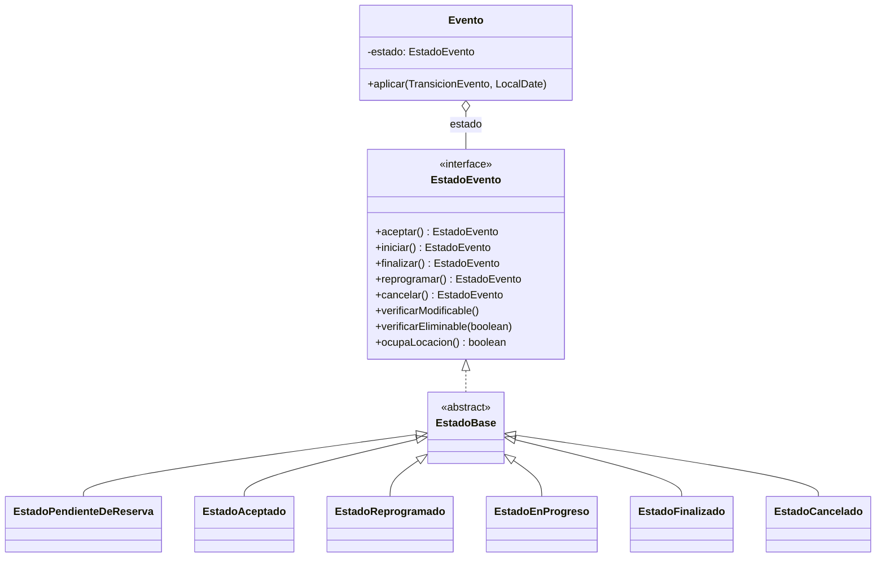

# Plataforma para Gestión de Eventos — Subsistema 1

**Consultora MSM · Ingeniería de Software II · Universidad FASTA**

Subsistema 1 del sistema de gestión de eventos: **Gestión de Eventos y Planificación**.
Se encarga de los usuarios y sus roles, las solicitudes de los clientes, la planificación de uno o varios eventos por
solicitud, los estados del evento, las locaciones y tipos de evento, las reglas de disponibilidad, la hoja de servicio
y la base de datos del sistema.

> Los Subsistemas 2 (Servicios, Menús, Proveedores y Personal) y 3 (Asistentes, Reservas, Pagos y Notificaciones)
> **no** están implementados. Solo se definen los puntos de contacto con ellos (ver [Integración](#integración-con-otros-subsistemas)).

La especificación de requisitos (SRS v1.1.4) está en [docs/SRS-Subsistema1-v1.1.4.pdf](docs/SRS-Subsistema1-v1.1.4.pdf).

## Tecnologías

- Java 8 o superior
- Swing (interfaz gráfica)
- PostgreSQL 12 o superior, con el driver JDBC `lib/postgresql-42.7.4.jar` (única librería externa)

## Cómo ejecutar

1. Instalar PostgreSQL y poner la contraseña del usuario `postgres` en `basedatos.properties` (`contrasena=`).
   No hace falta crear la base: al iniciar, el sistema crea `gestion_eventos` y sus tablas si no existen (CDU 007).
2. Ejecutar:

```bash
ejecutar.bat                                    # Windows: compila y abre la aplicación
./ejecutar.sh                                   # Linux / macOS
```

En IntelliJ IDEA: abrir la carpeta del proyecto y ejecutar la configuración **"Sistema de eventos"** (clase `app.Main`).
La configuración **"Demo usuarios (consola)"** (clase `app.DemoConsola`) recorre por consola los CDU 001 a 006.

Con `habilitado=false` en `basedatos.properties` el sistema arranca en **modo demostración**, con los datos en memoria
(se pierden al cerrar). Si PostgreSQL no responde al iniciar, ofrece reintentar, usar el modo demostración o salir.

### Usuarios de prueba en la base de datos

La primera vez la base está vacía y aparece la **Configuración inicial**: se crea el administrador (con los datos que
elijas) y, si se deja tildado **"Cargar datos de ejemplo"**, se guardan en la base los usuarios de abajo junto con
5 tipos de evento, 5 locaciones (una con fechas bloqueadas), 4 solicitudes y 2 planificaciones (un casamiento y un
congreso de 3 jornadas). Se hace una sola vez; después los datos quedan en la base.

| Rol | Correo | Contraseña | Qué ve |
|---|---|---|---|
| Organizador | maria@mail.com | Clave2026 | Planificaciones, Eventos, Calendario |
| Cliente | juan@mail.com | Clave2026 | Calendario (solo sus eventos) |
| Cliente | lucia@mail.com | Clave2026 | Calendario (solo sus eventos) |
| Sin rol | sofia@mail.com | Clave2026 | No puede ingresar hasta que le asignen un rol |

En modo demostración se cargan los mismos datos y además existe el administrador **admin@eventos.com** / **Admin2026**.

## Arquitectura

Arquitectura **MVC**: el modelo no conoce la interfaz gráfica (no importa nada de Swing, `vista` ni `controlador`), las
vistas solo muestran datos y avisan qué hizo el usuario, y cada controlador recibe esas acciones, se las pide al modelo
y decide qué mostrar. La persistencia se accede mediante interfaces de repositorio, con una implementación en
PostgreSQL y otra en memoria.

```
src
├── app                     Main (arranca la aplicación) y DemoConsola
├── modelo                  M de MVC
│   ├── Modelo              Arma el modelo con PostgreSQL o en memoria
│   ├── DatosDePrueba       Datos de ejemplo
│   ├── usuarios            CDU 001 a 006
│   │   ├── entidades       Usuario (Observer), Permiso, TokenRecuperacion, rol/ (Strategy + Factory Method)
│   │   ├── repositorio     UsuarioRepository, TokenRepository
│   │   ├── servicio        GestorUsuarios (Facade), correo SMTP real y bandeja simulada
│   │   └── seguridad       Hash de contraseñas (PBKDF2)
│   ├── eventos             CDU 008 a 015
│   │   ├── entidades       SolicitudEvento, Planificacion, Evento, HojaServicio, Locacion, BloqueoFecha,
│   │   │                   TipoEvento, EventoFactory (Factory Method)
│   │   ├── entidades/estado  EstadoEvento y sus 6 estados (State)
│   │   ├── exportacion     Exportador PDF / Excel / Word (Strategy)
│   │   ├── repositorio     Repositorios de cada entidad (Repository)
│   │   └── servicio        SistemaEventos y GestorCatalogos (Facade), ReglasPlanificacion
│   └── persistencia        CDU 007: BaseDeDatos, Esquema, repositorios *Postgres, ContextoPersistencia
│                           (transacciones), Respaldo y GestorBaseDatos (Facade)
├── vista                   V de MVC: una Vista* por pantalla, formularios y diálogos
└── controlador             C de MVC: un Controlador* por pantalla y PlanificadorEventos
```

## Patrón State en los estados del evento

Cada estado sabe qué transiciones admite y a qué estado pasa. `Evento` delega en su estado actual en lugar de
llenar el código de `if (estado == ...)`; una transición no permitida lanza `TransicionInvalidaException`.



| Rol del patrón | Clase |
|---|---|
| Contexto | `Evento` |
| Estado | `EstadoEvento` (con el comportamiento por defecto en `EstadoBase`) |
| Estados concretos | `EstadoPendienteDeReserva`, `EstadoAceptado`, `EstadoReprogramado`, `EstadoEnProgreso`, `EstadoFinalizado`, `EstadoCancelado` |

| Estado actual | Transiciones posibles | ¿Se puede eliminar? |
|---|---|---|
| PENDIENTE DE RESERVA | Aceptar, Reprogramar, Cancelar | Sí |
| ACEPTADO | Iniciar, Reprogramar, Cancelar | No (se cancela) |
| REPROGRAMADO | Aceptar, Reprogramar, Cancelar | Solo si nunca estuvo aceptado |
| EN PROGRESO | Finalizar | No |
| FINALIZADO | Ninguna | Sí |
| CANCELADO | Ninguna | Sí |

Otros patrones: **Strategy** (roles de usuario y exportadores de la hoja de servicio), **Factory Method**
(`RolFactory`, `EventoFactory`), **Repository**, **Facade** (`GestorUsuarios`, `SistemaEventos`, `GestorCatalogos`,
`GestorBaseDatos`) y **Observer** (el evento avisa a sus usuarios cuando cambia).

## Reglas de planificación

| Elemento | Qué reserva |
|---|---|
| Evento | Su locación desde el inicio del montaje hasta el fin del desmontaje (horario ± tiempo de montaje de la locación) |
| Solicitud pendiente o sin planificar | El día completo en su locación |
| Evento reprogramado o cancelado | Libera su horario anterior |

- Dos eventos en la misma locación no pueden superponerse; el mismo día puede haber más de uno si los horarios no se pisan.
- Las fechas tienen que ser futuras, la cantidad de personas no puede superar la capacidad, y la locación tiene que
  estar habilitada y sin la fecha bloqueada. Si no hay lugar, el sistema sugiere las locaciones disponibles.
- No se puede bajar la capacidad de una locación por debajo de una reserva, ni aumentar el tiempo de montaje si eso
  hace chocar eventos, ni bloquear fechas que tienen reservas.
- Lo que está en uso (locaciones, tipos de evento) no se elimina: se inhabilita o se desactiva.

## Solicitudes, planificación y eventos

Relación: `SolicitudEvento 1 -- 0..1 Planificacion 1 -- 1..* Evento`.

- Una solicitud nace **PENDIENTE**; el administrador la **acepta** o la **rechaza**. Al aceptarla se crea la
  planificación con su primer evento (PENDIENTE DE RESERVA) en la fecha pedida, con la hora y duración sugeridas del tipo.
- Desde Planificaciones se agregan más eventos en días consecutivos a la misma hora. Es todo o nada: si alguna fecha no
  está disponible, no se crea ningún evento.
- **Reprogramar todo** mueve los eventos activos la misma cantidad de días; **Cancelar todo** cancela los activos.
  Ninguna de las dos se permite con eventos EN PROGRESO.
- Al eliminar una solicitud con eventos, el sistema pregunta si también se eliminan: **Sí** borra la solicitud, su
  planificación y sus eventos (salvo que alguno esté ACEPTADO o EN PROGRESO); **No** oculta la solicitud (estado
  ELIMINADA) y conserva los eventos.
- La **hoja de servicio** reúne los datos del evento, horarios, locación, recursos logísticos (salida desde la sede,
  montaje, desmontaje), menú y consumos, y se exporta a PDF, Excel (.csv) y Word (.rtf).
- Cada operación se guarda en una transacción: se guarda completa o no se guarda.

## Requerimientos cubiertos

| RF | Descripción | Implementación |
|---|---|---|
| 001 | Registro de usuario | `GestorUsuarios.registrarUsuario` (correo y DNI únicos, contraseña con hash PBKDF2) |
| 002 | Iniciar sesión | `GestorUsuarios.iniciarSesion` |
| 003 | Restablecer contraseña | `GestorUsuarios.solicitarRecuperacion / restablecerContrasena` (código por correo, vence a los 30 minutos) |
| 004 | Gestionar usuario y contraseña | `GestorUsuarios.buscarUsuarios / eliminarUsuario` |
| 005 | Asignar roles | `GestorUsuarios.asignarRol`, `RolFactory` |
| 006 | Modificar usuario | `GestorUsuarios.modificarUsuario` |
| 007 | Gestionar base de datos | `BaseDeDatos.inicializar` (crea base y tablas), `GestorBaseDatos.respaldar / restaurar / verificarIntegridad`, respaldo automático diario |
| 008 | Crear solicitud | `SistemaEventos.crearSolicitud` + `ReglasPlanificacion` (disponibilidad y alternativas) |
| 009 | Modificar solicitud | `SistemaEventos.modificarSolicitud` |
| 010 | Eliminar solicitud | `SistemaEventos.eliminarSolicitud` (verifica si es parte de una planificación) |
| 011 | Crear evento | `SistemaEventos.aceptarSolicitud / planificarEventos`, `EventoFactory` |
| 012 | Eliminar evento | `SistemaEventos.eliminarEvento` (`EstadoEvento.verificarEliminable`) |
| 013 | Validar evento | `SistemaEventos.cambiarEstado` (patrón State) |
| 014 | Modificar evento | `SistemaEventos.modificarEvento` (`EstadoEvento.verificarModificable`) |
| 015 | Generar hoja de servicio | `SistemaEventos.generarHojaServicio`, `ExportadorPDF / ExportadorExcel / ExportadorWord` |

## Integración con otros subsistemas

| Subsistema | Punto de contacto | Estado |
|---|---|---|
| 2 – Servicios, Menús, Proveedores y Personal | `HojaServicio` (la crea el Subsistema 1; el Subsistema 2 le agrega servicios, personal y costos), `Locacion` | Las secciones de proveedores, personal y costos figuran como "Pendiente de asignación (Subsistema 2)" |
| 3 – Notificaciones | `Evento` avisa a sus observadores (`Observer`) y `Usuario` guarda los avisos | Se persisten en la tabla `notificaciones`; pendiente de definir con ese grupo |
| Persistencia | Interfaces `*Repository` | Implementación en PostgreSQL y en memoria (modo demostración) |

## Pruebas

No hay tests automatizados. Para probar el sistema:

- `DemoConsola`: recorre por consola los CDU 001 a 006 (registro, inicio de sesión, recuperación de contraseña,
  gestión de usuarios y roles), incluidos los casos de error.
- Datos de ejemplo: con la base recién creada se cargan usuarios, locaciones, solicitudes y eventos para probar la
  interfaz (ver [Usuarios de prueba](#usuarios-de-prueba-en-la-base-de-datos)).

## Pendiente

- Integración con el Subsistema 2 (servicios, personal y costos en la hoja de servicio).
- Integración con el Subsistema 3 (envío de notificaciones).
- Tests automatizados.
