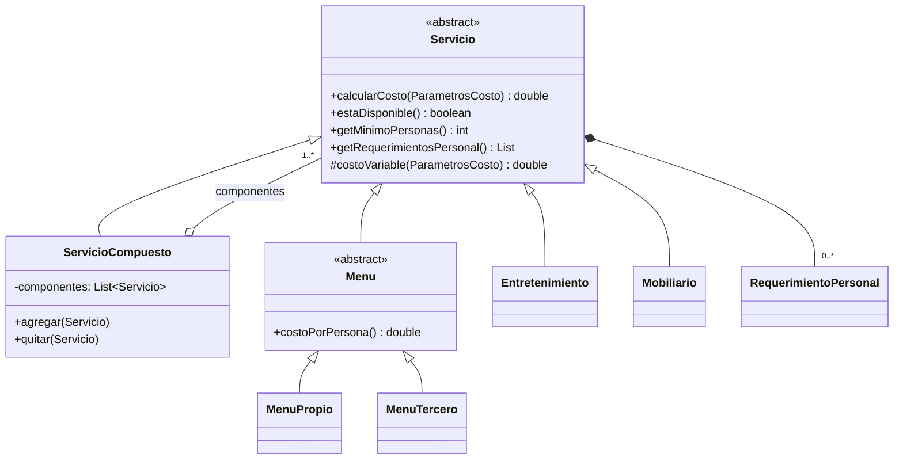

# Plataforma para Gestión de Eventos — Subsistema 2

**Consultora MSM · Ingeniería de Software II · Universidad FASTA**

Subsistema 2 del sistema de gestión de eventos: **Servicios, Menús, Proveedores y Personal**.
Se encarga de administrar el catálogo de servicios (simples y compuestos), los menús, los proveedores y el personal,
la disponibilidad y asignación de recursos a los eventos, y el cálculo del costo final de un evento.

> Los Subsistemas 1 (Eventos y Planificación) y 3 (Asistentes, Reservas, Pagos y Notificaciones) **no** están implementados.
> Solo se definen los puntos de contacto con ellos (ver [Integración](#integración-con-otros-subsistemas)).

## Tecnologías

- Java 17
- Maven
- JUnit 5

## Cómo ejecutar

```bash
mvn test                                        # compila y corre los tests
java -cp target/classes com.msm.eventos.App     # demo por consola
```

La demo registra proveedores, arma un servicio compuesto ("Paquete Fiesta"), carga personal con su disponibilidad,
asigna automáticamente el personal que requieren los servicios y muestra el costo desglosado del evento.

## Arquitectura

Arquitectura en capas con puertos y adaptadores: el dominio no depende de la infraestructura, y la persistencia y
las notificaciones se acceden mediante interfaces que después se pueden reemplazar (base de datos real, Subsistema 3).

```
src/main/java/com/msm/eventos
├── dominio                 Modelo de negocio (sin dependencias externas)
│   ├── comun               Identificable, FranjaHoraria, GeneradorCodigo, validaciones y excepciones
│   ├── usuario             Usuario, Administrador, Organizador
│   ├── proveedor           Proveedor
│   ├── servicio            Jerarquía Composite de servicios, menús, platos, mobiliario, entretenimiento
│   ├── recurso             RecursoAsignable, Personal, Locacion, DisponibilidadRecurso, AsignacionRecurso
│   └── evento              HojaServicio (punto de integración con el Subsistema 1)
├── aplicacion              Casos de uso
│   ├── puertos             Repositorio<T>, Notificador
│   ├── GestorProveedores   Alta, edición, baja lógica y consulta con filtros
│   ├── GestorServicios     Alta de servicios simples y compuestos, baja, menús por dieta, validación para eventos
│   ├── GestorPersonal      Alta, edición y baja del personal
│   ├── AsignadorRecursos   Disponibilidad, asignación, solapamientos, reprogramación, asistencia
│   └── CalculadorCostoEvento
├── infraestructura
│   ├── persistencia        RepositorioEnMemoria (provisorio)
│   └── notificacion        NotificadorConsola (provisorio hasta integrar el Subsistema 3)
└── App                     Armado de dependencias y demo
```

## Patrón Composite en los servicios

Un servicio puede ser simple o estar compuesto por otros servicios, que a su vez pueden ser compuestos.
El cliente (hoja de servicio, calculador de costos, asignador) trata a todos igual a través de `Servicio`.



| Rol del patrón | Clase |
|---|---|
| Componente | `Servicio` |
| Hojas | `MenuPropio`, `MenuTercero`, `Entretenimiento`, `Mobiliario` |
| Compuesto | `ServicioCompuesto` |

Operaciones que el compuesto resuelve delegando en sus componentes:

- **Costo:** `costoBase` del paquete + suma de los costos de cada componente (Template Method en `calcularCosto`).
- **Disponibilidad:** el compuesto está disponible solo si todos sus componentes lo están.
- **Mínimo de personas:** el mayor mínimo entre sus componentes.
- **Personal requerido:** los requerimientos propios más los de todos sus componentes.
- **Resumen:** árbol de texto con la estructura del paquete.

Se impiden los ciclos: un compuesto no puede contenerse a sí mismo, ni directa ni indirectamente.

## Cálculo de costos

| Servicio | Costo variable |
|---|---|
| `MenuPropio` | (Σ ingredientes de los platos × (1 + margen) + adicional) × personas |
| `MenuTercero` | precio por persona definido por el proveedor × personas |
| `Entretenimiento` | costo por hora × horas |
| `Mobiliario` | Σ cantidad × precio unitario de cada mueble |
| `ServicioCompuesto` | Σ costo de sus componentes |

Costo final del evento (`CalculadorCostoEvento`) = servicios + recursos asignados (tarifa por hora × horas)
+ logística (distancia a la locación × 2 × costo por km). Se calcula siempre sobre el estado actual de la hoja,
así que cualquier cambio se refleja al recalcular.

## Recursos, disponibilidad y asignación

- `Personal` y `Locacion` implementan `RecursoAsignable`.
- Cada recurso carga franjas de `DisponibilidadRecurso`; una `AsignacionRecurso` solo se crea si la franja del evento
  está cubierta por una disponibilidad y no se superpone con otra asignación del mismo recurso.
- Cada servicio declara `RequerimientoPersonal` (fijo o "uno cada N invitados"); `asignarPersonalRequerido` asigna
  automáticamente el personal faltante, o falla sin asignar nada si no alcanza.
- `reprogramarHoja` mueve las asignaciones a la nueva franja y cancela (y devuelve) las que ya no son posibles.
- Asignaciones, reprogramaciones y cancelaciones se informan por medio del puerto `Notificador`.

## Requerimientos cubiertos

| RF | Descripción | Implementación |
|---|---|---|
| 003 / 004 | Gestión y baja lógica de proveedores | `GestorProveedores` (la baja desactiva también sus servicios) |
| 005 | Gestión de servicios | `GestorServicios.registrar / editar / darDeBaja` |
| 006 | Consulta de proveedores con filtros | `FiltroProveedor` (rubro, tipo de servicio, disponibilidad) |
| 007 | Servicios compuestos | `ServicioCompuesto` + `GestorServicios.crearCompuesto` |
| 008 | Validación de disponibilidad de servicios | `Servicio.estaDisponible`, `GestorServicios.validarParaEvento` |
| 009 – 012 | Menús, clasificación, proveedor y mínimo de comensales | `Menu`, `TipoDieta`, `Proveedor.agregarServicio`, `getMinimoPersonas` |
| 013 | Selección de menús para eventos | `GestorServicios.agregarAHoja` |
| 014 / 015 | Gestión de personal con código automático | `GestorPersonal`, `GeneradorCodigo` (`PER-00001`) |
| 016 | Disponibilidad del personal | `AsignadorRecursos.registrarDisponibilidad` |
| 017 / 018 | Asignación sin solapamientos | `AsignadorRecursos.asignar / asignarPersonalRequerido` |
| 019 | Asistencia del personal | `AsignadorRecursos.registrarAsistencia` |
| 020 – 022 | Costo del menú y del evento | `MenuPropio.costoPorPersona`, `CalculadorCostoEvento` |
| 023 / 024 | Notificaciones de asignación y reprogramación | Puerto `Notificador` |

## Integración con otros subsistemas

| Subsistema | Punto de contacto | Estado |
|---|---|---|
| 1 – Eventos y Planificación | `HojaServicio` (la crea el Subsistema 1; aquí se le agregan servicios y asignaciones), `Locacion` | Modelo mínimo |
| 3 – Notificaciones | Interfaz `Notificador` | Adaptador de consola provisorio |
| Persistencia | Interfaz `Repositorio<T>` | Implementación en memoria provisoria |

## Tests

- `ServicioCompuestoTest`: costo recursivo, prevención de ciclos, disponibilidad, requerimientos y costo de menú propio.
- `AsignadorRecursosTest`: disponibilidad, solapamientos, asignación automática y reprogramación.
- `GestorProveedoresTest`: baja lógica en cascada y filtros de consulta.

## Pendiente

- Repositorios sobre la base de datos definitiva.
- Modalidad del servicio (buffet, emplatado, food truck) en el precio final.
- Capa de presentación e interfaces de usuario por actor.
